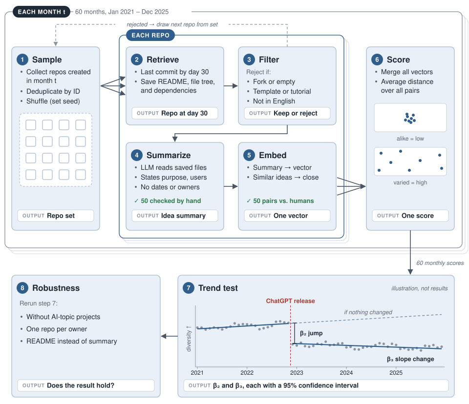
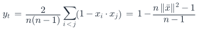
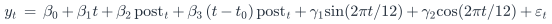

# **Are AI Coding Assistants Homogenizing What Developers Build?**

Group 4: Samuel Schneider, Spencer Caldwell, and Hezeki Webb  
Project Milestone • October 27, 2026

## **Executive Summary**

AI coding assistants may influence which software ideas developers pursue. If many developers rely on similar models, the projects they build may become more alike. The opposite is also possible: easier implementation may let more people build a wider range of projects. Doshi and Hauser \[3\] found that AI assistance improved evaluations of individual stories while making the collection of stories more similar. Whether this pattern extends to software projects is unknown.

**This project will measure whether the diversity of ideas in new public GitHub repositories changed after ChatGPT's release made generative AI tools widely available.**

For each month from January 2021 through December 2025, we will randomly sample new repositories and describe each project as it stood 30 days after creation. Each description becomes an embedding: a list of numbers that places similar meanings close together. A month's diversity score is the average distance between its embeddings. We will test whether the scores jumped or changed trend at ChatGPT's release. Manual review will check that the descriptions and distances capture the underlying ideas.

The output will be a reproducible Python pipeline, a 60-month diversity series, and estimates of the level and trend changes with 95% confidence intervals. The study measures implemented project choices, using repository creation as a proxy. It cannot identify who used AI or establish that AI caused a change. A reliable finding of greater diversity, lower diversity, or no clear difference would all answer the research question.

## **Solution and Implementation**

Figure 1\. System plan. Each month, step 1 builds a set of new repositories, steps 2–5 run on each repository separately, and step 6 merges the results into one diversity score. Step 7 fits a trend test to all 60 scores, and step 8 reruns it with three variations. The trend panel shows the shape of the test, not results.

### **Study design**

We study repositories created from January 2021 through December 2025, 60 months in total. ChatGPT was released on November 30, 2022 \[8\], so December 2022 is the first month after release. This splits the series into 23 months before and 37 months after. Starting in 2021 keeps the first year of the pandemic out of the pre-release trend.

ChatGPT is not the only AI tool in this window. GitHub Copilot became generally available on June 21, 2022 \[2\], so the pre-release months are not AI-free. Later tools, such as Claude Code (released as a research preview on February 24, 2025 \[1\]), fall in the post-release months. The design measures change at ChatGPT's release; it cannot separate the effects of these other tools.

## **Data Collection and Representation**

### **Sampling and historical retrieval**

GH Archive records public GitHub events, not complete repository contents \[4\]. We will query its BigQuery tables for CreateEvents whose ref_type is repository \[5\], deduplicate repository IDs, and randomly order candidates within each month using a saved seed. Sampling repository IDs rather than activity events avoids favoring projects with many commits. Every month gets the same number of eligible repositories. The pilot will measure how much monthly scores vary at a given sample size; we will then fix that number, expected to be 100–200 per month.

For each candidate, the GitHub API will retrieve metadata and the last available default-branch snapshot within 30 days of creation. Every repository is therefore described at the same age. We will save the README, file tree, dependency files, commit ID, and timestamps. Present-day descriptions, topics, stars, and later README revisions will not be model inputs. If the required snapshot cannot be recovered, we will record the failure and move to the next randomly ordered candidate. A pilot will measure retrieval time and eligibility rates before we commit to the full sample.

### **Filtering**

Filtering has two passes. A rejected repository is replaced by the next candidate in the shuffled list, and every rejection is logged with its reason.

**Rule pass.** Using API metadata and the saved snapshot, we reject a repository if it:

- is a fork or a mirror;
- has no source-code files, judged by file extension;
- has no README, a README under 30 words, or a README not detected as English;
- is a profile page, meaning the repository name equals the owner's username;
- has a README identical to one already kept that month.

**Language-model pass.** A language model reads the README and file tree and assigns one label:

- project: software built for the author's own purpose, of any size or popularity;
- tutorial: follows a named tutorial, course, or video step by step;
- coursework: a class assignment, lab, or exercise;
- template: an unmodified starter or boilerplate;
- not software: notes, link lists, configuration files, or dotfiles;
- unclear.

The model must quote the text that supports its label. Only "project" is kept. Every repository gets the same model, prompt, and settings, and dates and owners are withheld.

**Check.** Two team members independently label 100 candidates, half from before the release and half from after, without seeing the model's labels. We report their agreement and the model's precision and recall for "project". We also compare the model's error rates before and after the release, because a filter that errs differently in the two periods would bias the trend. We report rejection counts by reason and month. These rules select documented personal projects, not all GitHub repositories.

### **Idea extraction**

A language model will read the saved files and return an idea statement of at most 80 words: what the software does, who uses it, and its distinguishing function. It must cite supporting passages and return “insufficient evidence” when the purpose is unclear. It will not invent features or assign a predefined category. Dates, owner names, and period labels will be withheld. One model version, prompt, and input budget will be used for every repository; raw inputs and outputs will be cached. The pilot will determine the model and settings before the full run.

### **Embedding**

We embed each idea statement with all-MiniLM-L6-v2 \[10\], a sentence-embedding model that places statements with similar meanings close together \[9\]. Vectors are normalized to unit length. We embed summaries rather than raw READMEs so that writing style, including READMEs written with AI help, does not count as a difference in ideas.

## **Analysis, Validation, and Limitations**

### **Diversity score**

Month t's diversity score y_t is the mean cosine distance between all pairs of that month's idea vectors x₁, …, xₙ. Higher scores mean more varied ideas. Because the vectors have unit length, the score also equals a formula in their mean vector x̄:

The score therefore needs no pairwise loop, and its expected value does not depend on n.

### **Trend test**

We fit one regression to the 60 monthly scores from January 2021 through December 2025:

This is an interrupted time-series regression \[6\]: it fits a trend line before the release and lets that line jump and bend at the release.

- t: month number, from 1 (January 2021) to 60 (December 2025).
- post: 0 before December 2022 and 1 from December 2022 on. December 2022 (t₀ = 24) is the first full month after ChatGPT's release \[8\].
- β₀: diversity at the start of the series.
- β₁: monthly trend before the release.
- β₂: sudden jump or drop at the release.
- β₃: change in the monthly trend after the release.
- γ₁, γ₂: a pattern that repeats every year.
- εₜ: variation the model does not explain.

β₂ and β₃ answer the research question. We report each with a 95% confidence interval and plot the monthly scores with both fitted lines.

**Correcting for similar neighboring months.** Ordinary regression assumes each month's deviation from the fitted line is independent of the next. Monthly scores rarely behave that way: if one month runs unusually high, the following month often does too. Correlated months carry less independent information than 60 separate data points, much as polling 60 people from 20 households tells you less than polling 60 unrelated people. Ignoring this makes confidence intervals too narrow and can make noise look like a real jump at the release. Newey–West standard errors \[7\] leave the fitted lines unchanged and widen the intervals to account for correlation among nearby months. We will allow correlation up to three months apart, fixed before seeing the data.

### **Measurement checks**

Two team members independently check 50 summaries, spread across all years, against their source files. A summary passes if it states the project's purpose and main function without unsupported claims. The target is 90%. The same reviewers rate 50 summary pairs from 1 (unrelated) to 5 (same idea) without seeing dates or scores. We report the share of pairs rated within one point of each other and the Spearman correlation between ratings and cosine similarity. Failing either check means revising the prompt before the full run.

### **Robustness**

We rerun the same regression three ways:

1. Excluding projects whose summary is about AI or language models. This separates AI as a project topic from AI as a coding tool.
2. Keeping at most one repository per owner.
3. Embedding cleaned README text instead of summaries. This checks that summarization does not create the result.

### **Limitations**

The design shows whether diversity changed around ChatGPT's release, not that AI caused the change. Anything else that changed at the same time, such as who creates GitHub repositories, would produce the same pattern. The earlier period is not AI-free: Copilot became generally available in June 2022 \[2\]. Older repositories have had more time to be deleted or made private; we report retrieval failures by month to expose this. Results describe accessible, documented, English-language repositories, not all software.

## **Milestone Deliverables**

The design is complete. For the October 27 milestone, we set up the GitHub scraping pipeline and collected 200 unfiltered repository IDs per month across 60 months (12,000 unique IDs). Early-file retrieval, filtering, and analysis are next; the current candidates are not yet an eligible sample.

| Milestone                       | Status                                  | Group Member Lead |
| :------------------------------ | :-------------------------------------- | :---------------- |
| 1. Data pipeline                | In progress: candidate IDs collected    | Samuel            |
| 2. Representation and analysis  | Planned                                 | Spencer           |
| 3. Summary validation           | Planned                                 | Hezeki            |
| 4. Similarity validation        | Planned                                 | Hezeki            |

**Goal 1: Data pipeline.** Proposal plan: a 200-repository pilot with filtering counts. Current progress: the collection pipeline has saved 200 unfiltered repository IDs for each month. Next we will retrieve early snapshots, validate the filter, and record exclusions. Additional candidates may be needed to reach the final eligible sample size.

**Goal 2: Representation and analysis.** Proposal plan: idea records, diversity measures, and plots. Next we will summarize eligible repositories, embed the summaries, and calculate monthly diversity scores. No diversity scores have been computed for the study.

**Goal 3: Summary validation.** Proposal plan: two reviewers check 50 summaries. The review rubric and checks remain planned.

**Goal 4: Similarity validation.** Proposal plan: two reviewers rate 50 summary pairs. The rating guide and pair reviews remain planned.

## **Way Forward and Schedule**

| Dates        | Group goal                                                        | Lead    |
| :----------- | :---------------------------------------------------------------- | :------ |
| By Oct 27    | Set up scraping and collect candidate IDs.                        | Samuel  |
| Oct 28?Nov 8 | Test early snapshots, validate filtering, and freeze prompts.      | Spencer |
| Nov 9?20     | Complete eligible samples and human checks.                       | Spencer |
| Nov 21?final | Fit the trend test, run robustness checks, and present.           | Hezeki  |

All three members work on every stage; the lead coordinates it.

## **References**

\[1\] Anthropic. 2025\. Claude 3.7 Sonnet and Claude Code. (February 24, 2025). Retrieved October 23, 2026 from https\://www\.anthropic.com/news/claude-3-7-sonnet

\[2\] Thomas Dohmke. 2022\. GitHub Copilot is generally available to all developers. (June 21, 2022). Retrieved October 23, 2026 from https\://github.blog/news-insights/product-news/github-copilot-is-generally-available-to-all-developers/

\[3\] Anil R. Doshi and Oliver P. Hauser. 2024\. Generative AI enhances individual creativity but reduces the collective diversity of novel content. Science Advances 10, 28 (July 2024), eadn5290. https\://doi.org/10.1126/sciadv.adn5290

\[4\] GH Archive. n.d. GH Archive. Retrieved October 23, 2026 from https\://www\.gharchive.org/

\[5\] GitHub. n.d. GitHub event types. Retrieved October 23, 2026 from https\://docs.github.com/en/rest/using-the-rest-api/github-event-types

\[6\] James Lopez Bernal, Steven Cummins, and Antonio Gasparrini. 2017\. Interrupted time series regression for the evaluation of public health interventions: a tutorial. International Journal of Epidemiology 46, 1 (February 2017), 348–355. https\://doi.org/10.1093/ije/dyw098

\[7\] Whitney K. Newey and Kenneth D. West. 1987\. A Simple, Positive Semi-Definite, Heteroskedasticity and Autocorrelation Consistent Covariance Matrix. Econometrica 55, 3 (May 1987), 703–708. https\://doi.org/10.2307/1913610

\[8\] OpenAI. 2022\. Introducing ChatGPT. (November 30, 2022). Retrieved October 23, 2026 from https\://openai.com/index/chatgpt/

\[9\] Nils Reimers and Iryna Gurevych. 2019\. Sentence-BERT: Sentence Embeddings using Siamese BERT-Networks. In Proceedings of the 2019 Conference on Empirical Methods in Natural Language Processing and the 9th International Joint Conference on Natural Language Processing (EMNLP-IJCNLP). Association for Computational Linguistics, Hong Kong, China, 3982–3992. https\://doi.org/10.18653/v1/D19-1410

\[10\] Sentence Transformers. n.d. all-MiniLM-L6-v2. Hugging Face model card. Retrieved October 23, 2026 from https\://huggingface.co/sentence-transformers/all-MiniLM-L6-v2

## **Generative AI Documentation**

Drafting tool: GPT-6 through Codex. The model received our pre-proposal, proposal, instructor feedback, and milestone instructions. We asked it to develop the suggested repository comparison, research prior work, and write a terse local document in our style. The accompanying AI-use record preserves the writing request and follow-up instructions.

The proposed design keeps the comparison tied to actual repositories, uses the same project age and representation in every month, and separates observed differences from causal claims. These are reasons to consider the approach, not a substitute for team review. Team review is pending: before submission, record which suggestions we accepted or rejected and any errors we found. No empirical results are claimed in this draft.
