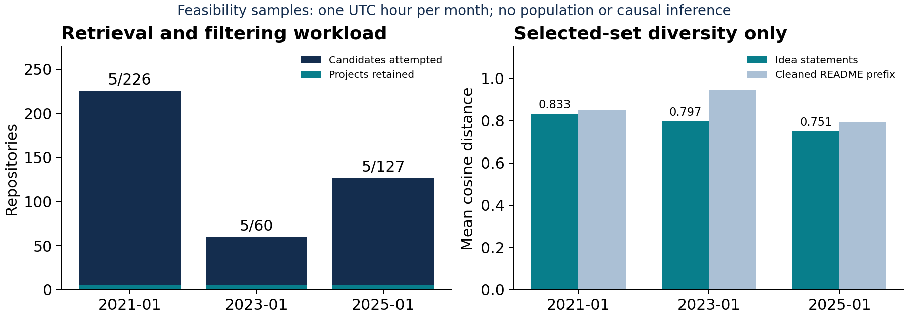

# Are AI Coding Assistants Homogenizing What Developers Build?

Group 4: Samuel Schneider, Spencer Caldwell, Hezeki Webb

October 27, 2026 milestone; draft for team review.

Group 4 | Samuel Schneider, Spencer Caldwell, Hezeki WebbOctober 27, 2026 milestone | Draft for team review

## Executive summary

AI coding assistants may affect which software ideas people pursue. Easier implementation could broaden the range of projects, while shared suggestions could make projects more alike. Doshi and Hauser [1] found greater similarity among AI-assisted stories; whether software project choices follow that pattern remains an open question.

We will measure whether the diversity of ideas in newly created public GitHub repositories changed around ChatGPT's release.

The proposed study samples 60 months, January 2021 through December 2025, and describes each repository using source material from its first 30 days. Short idea statements become embeddings; mean pairwise cosine distance measures the diversity of each selected set. The eventual analysis estimates level and slope changes from December 2022, the first full month after the November 30 release [6].

We have implemented an end-to-end feasibility pilot with 15 projects across 3 selected months, exceeding the original five-project target. We attempted 413 candidates, retained historical commit links and source hashes, generated evidence-linked statements with GLM 5.3 Flash, and computed MiniLM embeddings and diversity scores. Estimated API cost is $0.0301; conservative reservations total $0.4012, below the $5 limit. The most useful initial result is a measured account of retrieval and filtering failures.

This is a pipeline demonstration, not evidence that AI changed software diversity. The pilot uses one UTC hour per month rather than whole-month samples. Independent human review, full-month sampling and the 60-month regression remain pending.

Implemented: archive -> historical source -> GLM filter/idea -> MiniLM -> diversity. Planned: full-month samples, human validation, 60-month regression.

## Proposed solution and implementation

Inputs and sampling. GH Archive supplies public CreateEvents [2]. The pilot downloads January 15, 12:00-12:59 UTC in 2021, 2023 and 2025. We keep repository-creation events, deduplicate IDs, and order candidates by SHA256(seed:repository_id), with seed 448-pilot-v1. Rejections are replaced in that saved order. This is reproducible ordering within each hourly frame, not a random sample of a month. The prepared BigQuery query in sample.sql covers an entire month; it has not been run or billed.

Historical retrieval. Repository IDs resolve current metadata. We query ancestors of the currently observed default branch with GitHub's until parameter [3], select the returned commit, and require its committer timestamp to fall between creation and creation + 30 days. We recover its tree and README blob, saving the commit, tree and content hashes. This does not recover the historical default-branch name, prove public availability at the cutoff, or detect backdated commits and rewritten history. Imported histories with earlier timestamps are excluded.

Filtering. Reject forks/mirrors, profile repositories, missing source extensions, truncated trees, absent/short/non-English READMEs, and within-month duplicate retained READMEs. The extension allowlist includes HTML, CSS, SQL and notebooks. READMEs over 200 KB are excluded. English detection is seeded. GLM assigns project, tutorial, coursework, template, not software or unclear; only project passes. Schema failures and non-verbatim evidence quotes are recorded as model failures, never as accepted projects.

Representation. Every final extraction request uses the same prompt, temperature 0, low reasoning and 3,072 output-token cap. Input is bounded to 12,000 historical README characters; the file tree supports eligibility checks. We removed paths from model input after diagnostic runs inferred unsupported features from filenames. Identity/URL/date redaction is best effort. The model outputs an idea of at most 80 words and evidence quotes. Full inputs/responses are cached locally; the public index publishes concise quotes, source links and request hashes. Dependency-file retrieval is deferred.

Measurement and outputs. all-MiniLM-L6-v2 [4], pinned to one model revision, produces normalized 384-dimensional vectors. For n vectors, diversity = n/(n-1) * (1 - squared norm of their mean). Offline tests check this formula against explicit pairwise distances. We also compute leave-one-out ranges, a cleaned README-prefix baseline, AI-topic exclusion and within-month owner deduplication. MiniLM truncates long inputs at its 256 word-piece limit; the README baseline is therefore a prefix check. No repository code is executed.

## Pilot results and interpretation

| Hourly frame | Attempted | Retained | Idea distance | README distance |
|---|---|---|---|---|
| 2021-01 | 226 | 5 | 0.8328 | 0.8513 |
| 2023-01 | 60 | 5 | 0.7969 | 0.9472 |
| 2025-01 | 127 | 5 | 0.7509 | 0.7947 |

Across these frames, 192/413 attempts returned HTTP 404 (unavailable; deletion and privacy cannot be distinguished). There were 4 invalid model outputs. Per-candidate reasons and complete candidate order are in results/pilot.json. Frame-specific stopping at the target means that attempted counts are workload measures, not equally sized surveys of each frame.

Higher distance means greater spread among these retained ideas. The values are descriptive; three sparse hourly samples cannot support a temporal trend, a before/after significance test or causal attribution. README and idea scores measure different representations and are not interchangeable. Stored bootstrap intervals condition on the selected projects; they are not confidence intervals for monthly populations.

Example, R01. A web application that clones Instagram functionality, displaying posts and user profiles. Built as a Django app intended for deployment on Heroku.Evidence: displays posts and profiles of different usersInspect the historical README at the recorded commit.

Main threats. Accessibility and documentation select the sample; language and extension rules exclude some software; model errors can differ over time; summaries may preserve implementation style or hallucinate purpose. Current-branch ancestry is an imperfect historical reconstruction. Future models may know these repositories, so redaction does not guarantee blindness. Broader changes in GitHub users and projects can explain any eventual trend.

## Milestones and validation

| Deliverable / proposal plan | Current status | Lead |
|---|---|---|
| 1. Data pipeline / 200-repository pilot | Working historical pipeline; 413 attempted, 15 retained across three frames. Whole-month sampling pending. | Samuel |
| 2. Representation and analysis / ideas, scores, plots | Implemented for pilot: summaries, embeddings, scores, baseline and sensitivities. Full trend pending. | Spencer |
| 3. Summary validation / two reviewers, 50 summaries | Rubric and pilot worksheets prepared; automated evidence checks run. Independent human review pending. | Hezeki |
| 4. Similarity validation / two reviewers, 50 pairs | 1-5 anchors and 50 blinded pair rows prepared. Human ratings and correlation pending. | Hezeki |

Goal 1. The initial October 27 target was five projects from one month. The pilot now connects archive collection, historical retrieval, filtering and representation across three frames. Saved decisions expose failures. The proposal's representative monthly sample is still a separate task.

Goal 2. Public records contain ideas, quotes, hashes, historical links, normalized vectors and descriptive sensitivity results. Re-running verification needs no key or paid call. A single-command builder regenerates this five-page report, PDF slides, the result figure and blank reviewer sheets.

Goals 3 and 4. REVIEW.md defines categories, summary checks and 1-5 similarity anchors. Blank sheets cover all pilot summaries and 50 pairs. An AI source audit inspected all 15 summaries, flagging two platform inferences and two filter ambiguities (configuration versus software; possible upstream copy). These notes are in the evidence index. Two people must independently review before adjudication. The full-study summary target is 45/50 passing; filter precision/recall must include rejects. No human accuracy or agreement is claimed.

## Way forward and schedule

| When | Next concrete outcome | Lead |
|---|---|---|
| Oct 25-27 | Team checks evidence/AI disclosure, independently reviews pilot summaries and pairs, rehearses 10-minute talk. | All; Hezeki coordinates reviews |
| Oct 28-Nov 8 | Whole-month candidate frames, period-stratified filter audit, historical-branch sensitivity; expand several months and choose n/prompt. | Samuel + Spencer |
| Nov 9-20 | Run 60 months; finish 100-candidate, 50-summary and 50-pair checks; report monthly retrieval losses. | Spencer + Hezeki |
| Nov 21-final | Fit segmented regression; robustness, interpretation, final paper and talk. | All; Hezeki coordinates |

## Full-study analysis and references

After representative monthly collection and human checks, fit a segmented time-series model [5] to 60 monthly scores: linear time, post-December-2022 indicator, time since that breakpoint, and annual sine/cosine terms. Report level and slope changes with Newey-West [8] 95% intervals and diagnose autocorrelation. Repeat without AI-topic projects, with one repository per owner across the study, and using cleaned README embeddings. These full-study checks have not been completed. The pilot owner check is within each month only.

[1] Anil R. Doshi and Oliver P. Hauser. 2024. Generative AI enhances individual creativity but reduces the collective diversity of novel content. Science Advances 10, 28, eadn5290. https://doi.org/10.1126/sciadv.adn5290

[2] GH Archive. n.d. GH Archive: public GitHub timeline and hourly archives. Retrieved October 24, 2026. https://www.gharchive.org/

[3] GitHub. n.d. REST API endpoints for commits. Retrieved October 24, 2026. https://docs.github.com/en/rest/commits/commits#list-commits

[4] Sentence Transformers. n.d. all-MiniLM-L6-v2 model card. Retrieved October 24, 2026. https://huggingface.co/sentence-transformers/all-MiniLM-L6-v2

[5] James Lopez Bernal, Steven Cummins, and Antonio Gasparrini. 2017. Interrupted time series regression for the evaluation of public health interventions: a tutorial. International Journal of Epidemiology 46, 1, 348-355. https://doi.org/10.1093/ije/dyw098

[6] OpenAI. 2022. Introducing ChatGPT. November 30, 2022. https://openai.com/index/chatgpt/

[7] Prime Intellect. n.d. Prime Inference; live model catalog and pricing. Retrieved October 24, 2026. https://docs.primeintellect.ai/inference/overview

[8] Whitney K. Newey and Kenneth D. West. 1987. A Simple, Positive Semi-Definite, Heteroskedasticity and Autocorrelation Consistent Covariance Matrix. Econometrica 55, 3, 703-708. https://doi.org/10.2307/1913610

## Generative AI use and submission checks

GPT-6 through Codex implemented the pipeline, tests, draft prose and PDF materials. GLM 5.3 Flash generated project idea statements/classifications and study-improvement suggestions. Inputs were this repository's plan, the user's instructions and historical README/path evidence. The complete extraction prompt is stored in results/pilot.json and pilot.py. The attached AI_USE.md records user/extraction prompts, settings, reasoning, errors and the advice prompt/response location. An online copy is linked from the repository README. Review the attachment with this submission.

Observed model errors include missing required fields and quotes drawn from file paths rather than the README; those outputs were rejected. Passing automatic checks establishes only format and quote fidelity, not factual completeness. The reason to retain the method is reproducible, source-linked measurement with explicit rejection logs, not unverified trust in generated prose. Team members must record their own acceptance/rejection decisions and corrections in AI_USE.md before submission. The drafts do not claim that any named teammate has performed this review.

Submit Group4_Milestone_Writeup.pdf and Group4_Milestone_Presentation.pdf by October 27, 2026, 8:59 AM America/New_York, with the AI-use record as required by the course. The report is five pages; the talk is planned for ten minutes with each member speaking. Source-linked pilot details and blank review sheets remain in the repository.
